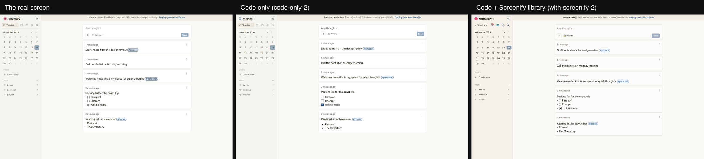

# Benchmark: what does the app look like, with and without Screenify

Two small tests on one open-source app, run on 2026-11-14 with Claude Sonnet 5.5. Everything
needed to check or repeat them is in this folder, including the runs that went badly.

**These scenarios were chosen where Screenify should help most**: questions about what is on
screen, asked about screens the library has captured. They do not show that screenshots help with
every coding task.

## Test 1: twenty questions about what is on screen

Twenty questions about what a newly signed-up member of [Memos](https://github.com/usememos/memos)
sees at desktop width: labels, the order of sections, default switch positions, layout. Three
ways of answering, three runs each, same model and prompt:

- **Code only**: a clean checkout of the repository.
- **Code + Screenify**: the same checkout with a Screenify library in it (`screenify-out/` and the
  one-line pointer `screenify init` adds to `AGENTS.md`).
- **Browse it yourself**: a clean checkout plus a running copy of the app (one per run) that the
  agent may open in a headless browser, sign up on and screenshot as it likes.

| | Code only | Code + Screenify | Browse it yourself |
| --- | --- | --- | --- |
| Correct answers (3 runs × 20) | 52 / 60 (87%) | **60 / 60 (100%)** | 55 / 60 (92%) |
| Per run | 18, 17, 17 | 20, 20, 20 | 18, 19, 18 |
| Cost per run, list price | $1.27 | **$0.40** | $0.52 |
| Time per run | 110 s | **30 s** | 235 s (101–392) |
| Tool calls per run | 27 | **9** | 15 |
| Needs a running app and an account | no | no | yes |

Cost is computed from each run's own input, output, cache-write and cache-read token counts at list
price ([`usage.json`](usage.json)). Every model call in these runs starts with the same ~92k-token
agent harness prompt; that overhead is in every column. Beyond it, the agent held on average about
60k tokens of reading per call without the library and about 20k with it.

What went wrong without the library: the code-only runs answered from what the code *can* render,
so they gave the label the theme selector has on another page, invented counts next to the inbox
filters, and listed a hover-only control as always visible. The browse runs looked at the real app
but described their own brand-new account: a sample memo inside the welcome dialog read as a real
memo card, a "New" badge that only appears on a memo created seconds ago. Reasons for every lost
point are in [`grades.json`](grades.json).

**Grading.** A separate model graded all nine answer sets in one pass under shuffled neutral names,
one point per question, no half points, against [`answer-key.md`](answer-key.md), which was written
from the running app before any run. An earlier pass that graded only the first two arms gave code
only 55/60 and the library 60/60 ([`grades-first-pass.json`](grades-first-pass.json)); the
headline uses the pass that graded all three arms to the same standard.

**Discarded runs.** A first batch of the browse-it-yourself arm shared one copy of the app; its
limit on new sign-ups blocked two runs from seeing parts of it, so that batch was thrown away and
rerun with one copy per run. It is not in the numbers.

**The library's cost.** Building it took $1.67 at list price (discovery on Sonnet $0.99, capture on
Haiku $0.69) and about 14 minutes, once. Against code only it saves about $0.87 per twenty
questions, so it pays for itself after about 40 questions. Against browsing it saves about $0.12
per twenty questions (about 280 questions to pay back) and takes an eighth of the time, without a
running app or an account.

## Test 2: redraw three screens

Each run writes three standalone HTML pages reproducing a real screen without running the app:
Settings > Preferences, About, and the home timeline with five given memos
([`redraw/task.md`](redraw/task.md)). Pages were rendered at 1440×900 and a separate model scored
each against the real screenshot under shuffled names, 0 to 10 per criterion
([`redraw/scores.json`](redraw/scores.json)). The library contains a capture of all three screens,
so this is the most favourable case for it.

| Overall closeness (0–10) | Preferences | About | Home | Average |
| --- | --- | --- | --- | --- |
| Code only | 9, 9, 9 | 9, 9, 8 | 6, 5, 4 | **7.6** |
| Code + Screenify | 8, 7, 7 | 9, 6, 5 | 6, 7, 7 | 6.9 |

| Per criterion (average) | Layout | Words | Order | Nothing missing | Nothing invented | Cost per run | Time per run |
| --- | --- | --- | --- | --- | --- | --- | --- |
| Code only | 8.4 | 8.9 | 10 | 9.1 | 8.1 | $2.28 | 363 s |
| Code + Screenify | 7.4 | 9.7 | 10 | 8.7 | 7.0 | $1.04 | 213 s |

**The library did not win this test on looks.** The code-only runs copied the app's own colours,
fonts and icon shapes from the source and produced polished pages; where the screen is mostly
fixed text (Preferences, About) they were nearly exact. Where the screen shows real content (Home)
they invented what the code suggests: ticked checkboxes, a struck-through item and bullets, where
the real app shows the typed text as it is. The library runs got every word and state right but
drew icons from emoji or by hand, because a screenshot shows an icon without saying which one it
is, and the scorer marked that down.

One library run (with-screenify-1) never opened the screenshots and worked from the code; it cost
as much as the code-only runs. The other two cost $0.47 and $0.57.

What this says for Screenify: an agent should take *what is shown* from the screenshot and *how it
is built* (icons, styles, components) from the code. The capture and reading instructions will say
so.

Side-by-side images use, per arm and screen, the run with the median score
([`redraw/side-by-side/`](redraw/side-by-side/)); all eighteen renders and their HTML are in
[`redraw/renders/`](redraw/renders/) and [`redraw/pages/`](redraw/pages/).

## Method

- **App.** Memos v26.11.0 (MIT), started with
  `docker run -d -p 5231:5230 -e MEMOS_DEMO=true neosmemo/memos:26.11.0`.
- **Library.** Built by the normal Screenify flow on a checkout of the same tag: discovery by a
  Sonnet agent (33 screens and 14 flows planned), capture by a Haiku agent, which signed up one test
  account, added five memos and filed 18 reviewed images of 17 screens and one flow. A sample is in
  [`library-sample/`](library-sample/).
- **Coverage.** 17 of the 33 planned screens were captured. The ten admin-only settings screens need
  an administrator account, which the demo does not give to visitors; the rest were not reached in
  the capture agent's one-hour budget. Every question in Test 1 is about a captured screen.
- **Runs.** Same model (Claude Sonnet 5.5) and prompt per arm; agents could not see the answer key;
  raw answers are in [`answers/`](answers/). Time and tool calls are what the agent harness
  reported.

## What this does not show

- **One small, tidy app, three runs per arm.** Memos keeps its text in locale files, the easy case
  for reading code. A larger or more fragmented app may widen or narrow the gaps; this test cannot
  say.
- **Only screens that were captured, and only still images.** Screenify files states a recipe can
  stop on (a page, an open menu, a dialog); it does not show animations or transitions. For a
  screen that is not in the library the agent is back to reading code.
- **Factual questions and look-alike redraws only.** Whether designs or feature suggestions come
  out better needs a different, human-judged test.
- **The machine was busy** during the runs, so absolute times are slow for every arm.

## Repeating it

1. Start Memos with the command above and check out the tag `26.11.0` of its repository.
2. In the checkout, run `screenify init`, then ask your agent to use the `screenify` skill.
3. Give fresh agents `questions.md` (or `redraw/task.md`) with a clean checkout, the checkout with
   the library, and a clean checkout plus a running copy of the app; grade against
   `answer-key.md` (or score against the real screenshots).
