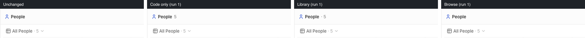

# Test 4: does the new pointer get agents to open the library, and does it help?

Run on 2026-11-15 with Claude Haiku 5.5, after the change that puts the library pointer at the top
of `AGENTS.md`/`CLAUDE.md`, installs the `screenify` skill in the repository, and opens `INDEX.md`
with "before adding or changing a screen, dialog, menu or state, open the nearest existing screens
and flows below". Two apps, three runs per arm, every run graded blind.

In the earlier build-on-it test (Sonnet, Memos) no library run opened a screenshot. This test asks
two things: does the new wording change what agents open, and does it change the result.

## Results

### Memos (small app), three feature requests, 17-item checklist

| | Code only | Old pointer | New pointer |
| --- | --- | --- | --- |
| Checklist score (3 runs × 17) | 47 / 51 | **49 / 51** | 48 / 51 |
| Per run | 15, 15, 17 | 16, 16, 17 | 16, 16, 16 |
| Runs that opened `INDEX.md` | 0 / 3 | 0 / 3 | **3 / 3** |
| Text descriptions (sidecars) opened, per run | 0 | 0 | 1, 3, 2 |
| Screenshots opened | 0 | 0 | 0 |
| Cost per run, list price | $0.045 | $0.034 | $0.191 |
| Time per run | 148 s | 128 s | 274 s |

**A tie on score.** The new pointer works as a pointer: every run read the index and one to three
text descriptions before its first edit, where no old-pointer run did. It did not change the score,
and no run opened an image. Most lost points in every arm are the same one: the new "edited" label
drawn smaller than the time beside it, a detail of looks that a screenshot shows and a text
description does not.

The two expensive new-pointer runs found the project's locale test while reading around the
library and added their new label to all 46 locale files; they are the only Haiku runs that pass
the locale tests ([`memos/tests.json`](memos/tests.json)). Their extra cost is that work.

### Twenty (large app), three feature requests, 16-item checklist

| | Code only | Code + Screenify | Browse it yourself |
| --- | --- | --- | --- |
| Checklist score (3 runs × 16) | 42 / 48 | **48 / 48** | 47 / 48 |
| Per run | 14, 12, 16 | 16, 16, 16 | 16, 16, 15 |
| Runs that opened `INDEX.md` | 0 / 3 | **3 / 3** | 0 / 3 |
| Screenshots / sidecars opened, per run | 0 | 1 image; none; 1 sidecar | 0 |
| Cost per run, list price | **$0.15** | $0.24 | $0.50 |
| Time per run | **213 s** | 222 s | 1,051 s |
| Needs a running app and an account | no | no | yes |

**The library arm scored full marks; code only lost six points in two runs.** The three requests
were built to test whether an agent builds on what exists:

1. Export selected people to CSV: it already exists. All nine runs saw that and added nothing.
2. A hover copy button for addresses, like emails and links have: the right change extends one
   shared hook. One code-only run built its own button inside the address display instead, with a
   different icon style, label and toast, and claimed emails and links have no copy button
   (4 points).
3. A record count near the title: the view picker right under it already shows one. One code-only
   run and one browse run added a second count query instead of reusing the existing count
   (1 point each); the code-only one also made a new prop required without updating two other
   callers, so the web app no longer type-checks (1 point).

Every library run and every browse run extended the shared hook. Three runs out of nine per arm is
small: the gap is two code-only runs, and a third code-only run scored full marks at the lowest
cost of all. Read it as "the library did not hurt and may help on a large app", not as a measured
effect size.

The browse arm matched the library on score at twice the cost and five times the time, and one of
its runs never got past the app's sign-up flow in its browser.

The code-only run wrote "People 5"; the library run wrote "People · 5", matching the separator the
view picker uses below it; the browse run left the title alone because the count is already there.

## What this says for Screenify

- **The pointer fix works.** With the new wording, 6 of 6 library runs across both apps opened the
  index before editing; with the old wording, 0 of 3 did.
- **Agents read the text, not the pictures.** Only 1 of 6 opened an image. For questions of *what
  exists* (a command, a count, a button) the text descriptions were enough. For questions of *how
  it looks* (size, weight, colour) they are not, and that is where Memos lost points in every arm.
  A follow-up change to the instructions should send agents to the image itself when the change is
  about looks.

## Method

- **Runs.** Each run is a fresh headless Claude Code session (`claude -p --model haiku`) started in
  its own checkout, so it loads that checkout's `AGENTS.md`/`CLAUDE.md` and repository skills as a
  developer's session would; user settings and MCP servers are not loaded. The tools are Read,
  Edit, Write, Glob, Grep and Skill; the browse arm also gets `node` to drive a headless browser
  against its own fresh copy of the app. This differs from the earlier Sonnet tests, which used
  subagents. What a run opened is counted from its own tool calls ([`memos/usage.json`](memos/usage.json),
  [`twenty/usage.json`](twenty/usage.json)), not from its reply.
- **Apps.** Memos v26.11.0 (the same tasks and checklist as the earlier build-on-it test) and
  Twenty v2.58.0, run from the official `twentycrm/twenty:v2.58.0` image with each run's web app
  built from its checkout and served in place of the image's own. Each run's screenshots are taken
  on a fresh database by one script ([`twenty/screens/`](twenty/screens/)).
- **Arms.** Memos: a clean checkout; the checkout with the library and the earlier pointer line at
  the end of `AGENTS.md`; the checkout with the library, the new pointer, the repository skill and
  the new `INDEX.md` header (the library files themselves are the same). Twenty: a clean checkout;
  the checkout with a library built by the normal flow (discovery on Sonnet, capture on Haiku, 44
  captures) and the new pointer; a clean checkout plus a running copy of the app.
- **Tasks and checklists** ([`memos/`](memos/), [`twenty/`](twenty/)) were fixed before any run.
  The Twenty checklist says "17 items" but lists 16; it was graded on the 16 it lists.
- **Grading.** A separate Claude Opus 5.5 agent graded the nine runs of each app in one pass under
  shuffled names, from each run's diff, its final reply with sentences naming the library or a
  browser blanked, and screenshots of its built app beside the unchanged app's. Reasons for every
  point are in [`memos/grades.json`](memos/grades.json) and [`twenty/grades.json`](twenty/grades.json).
- **Library coverage.** The Twenty library had the record tables, the selection state, the view
  picker with its count, the command menu (which lists Export View) and record pages. It did not
  have the ⋮ menu with rows selected or the hover copy button.

## Things that went wrong

- **The machine was overloaded** (other work in parallel) during the first round of Twenty builds,
  and several web builds failed with a build-worker timeout unrelated to the code. Everything was
  then rerun one item at a time; six of nine builds still needed one or two retries for the same
  timeout, and every attempt's log was kept. Memos test suites first run under that load gave
  unreliable results; they were thrown away and rerun one at a time ([`memos/tests.json`](memos/tests.json)).
- **One browse run (browse-3) started late** because its copy of the app did not become healthy
  while a build was running. It ran later on its own. Its session ended with a follow-up message
  about a stuck background script, so its full report is the earlier message, kept in its reply
  file; its time comes from the wall clock because the session's own timer covered only the
  follow-up.
- **One code-only run's tool calls mention `screenify-out`** (a search pattern that excluded it, as
  the prompt asked); there is no library in that checkout.
- **Test results for Memos** count failures from tests the runs did not update (menu tests that
  list the menu items, mocks missing a new hook, locale files), not features that stopped working.
  Unchanged Memos passes all its tests.

## Files

- `memos/`, `twenty/`: tasks, checklist, every run's diff and reply, grades, usage, screenshots;
  `memos/tests.json` is the Memos test suite on every run, including the Sonnet runs of the
  earlier test.
- `side-by-side/`: the images above, plus Memos' menu and detail views across the three arms.
